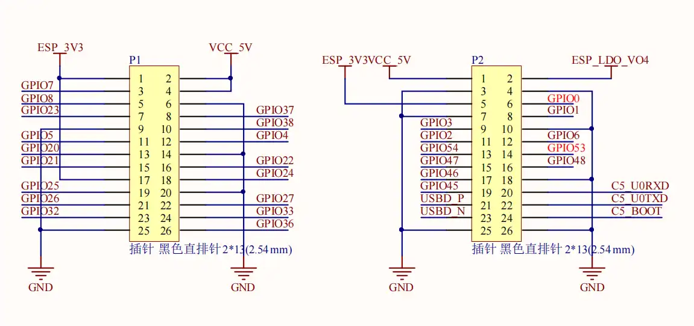
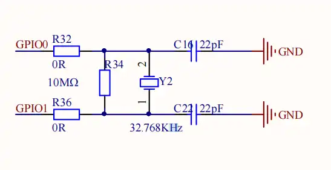

# ESP32-P4-NANO-WIFI6-DB <!-- omit in toc -->

[Simplified Chinese](../../zh_CN/hw-reference/user-guide.md)

This user guide will help you get started with ESP32-P4-NANO-WIFI6-DB and will also provide more in-depth information.

ESP32-P4-NANO-WIFI6-DB is a development board built around the ESP32-P4NRW32X processor, paired with an ESP32-C5-MINI-1U wireless coprocessor over SDIO. It provides a two-lane MIPI-DSI display and touch interface, a two-lane MIPI-CSI camera interface, ES8311 audio, microSD, RMII Ethernet, USB 2.0 Host and two 2×13 expansion headers.

The document consists of the following major sections:

- [Getting Started](#1-getting-started): Overview of the board, its onboard resources, peripherals and factory firmware.
- [Start Application Development](#2-start-application-development): Required hardware, power options and bring-up steps.
- [Hardware Reference](#3-hardware-reference): GPIO allocation, expansion headers, connectors, the crystal circuit and usage notes.
- [Related Documents](#4-related-documents): Links to related documentation.

> **Note**
>
> This page is compiled from the [official documentation](https://docs.waveshare.com/ESP32-P4-NANO-WIFI6-DB/). For circuit details, see the [schematic](../../../hardware/schematics/ESP32-P4-NANO-WIFI6-DB.pdf).

# 1. Getting Started

## 1.1. Overview

The ESP32-P4NRW32X main processor handles the display, camera, audio, storage, Ethernet and USB interfaces. The ESP32-C5-MINI-1U acts as a wireless coprocessor and provides 2.4 / 5 GHz Wi-Fi 6 and Bluetooth 5 LE to the ESP32-P4 through ESP-Hosted (four-bit SDIO). The ESP32-P4 has no integrated Wi-Fi or Bluetooth, so wireless features require the P4 application and the C5 coprocessor firmware to run together.

## 1.2. Onboard Resources

The table below lists the key components of the board.

<b>Onboard resources table</b>

| Key Component | Description |
| --- | --- |
| Main processor | ESP32-P4NRW32X — dual-core high-performance RISC-V system and a single-core low-power system, with 16 MB package-integrated PSRAM. |
| Flash | 16 MB external flash. |
| Wireless coprocessor | ESP32-C5-MINI-1U with an external antenna, supporting 2.4 / 5 GHz Wi-Fi 6 and Bluetooth 5 LE, connected to the ESP32-P4 over four-bit SDIO. ESP32-P4 GPIO54 is the C5 enable/reset (high enables, low resets); GPIO6 is connected to C5 IO2. |
| Ethernet | RMII MAC with IP101GRI PHY at PHY address 1 and a 50 MHz external REF_CLK input, on a 100 Mbit RJ45 connector, plus a header for the compatible optional PoE module. |
| Display | Two-lane MIPI-DSI for external Waveshare panels (see [Display and Camera Connectors](#33-display-and-camera-connectors)). The LCD reset pin is not connected; the backlight is controlled over I2C. |
| Touch | GT911 capacitive touch on the shared GPIO7/GPIO8 I2C bus; the I2C address is 0x5D or 0x14, reset and interrupt are not connected to the ESP32-P4, and touch status has to be read by polling. |
| Audio | ES8311 codec over I2C + I2S with MCLK on GPIO13; speaker output through an amplifier enabled by GPIO53; one onboard analog microphone input. |
| Storage | microSD slot over four-bit SDMMC (slot 0); card power switched by GPIO45 (active low), with IO voltage supplied by on-chip LDO channel 4. |
| Camera | Two-lane MIPI-CSI connector with SCCB on the shared I2C bus, for OV5647 camera modules. CSI_IO0/CSI_IO1 on the connector are pulled up only, so reset and power-down are not wired to the ESP32-P4. |
| USB | USB 2.0 high-speed OTG on a Type-A connector, on the ESP32-P4 internal USB PHY. |
| UART0 | Firmware download and serial logs on GPIO37 (TX) / GPIO38 (RX), exposed on the onboard USB Type-C connector, which also supplies 5 V. |
| Expansion headers | Two 2×13 headers (see [Expansion Headers](#32-expansion-headers)) exposing power, I2C, UART and GPIO, some of which are shared with onboard functions. |
| Buttons / indicator | BOOT and RESET buttons and a power indicator. |
| 32.768 kHz crystal | On GPIO0/GPIO1 (XTAL_32K_N/P), provides the ESP32-P4 RTC slow clock. |

## 1.3. Peripheral Quick Reference

<b>Peripheral quick reference table</b>

| Module | Device / Function | Interface | Address / Parameters | GPIO / Signal |
| --- | --- | --- | --- | --- |
| LCD | MIPI-DSI panel | MIPI-DSI | 2-lane; HX8394 / ILI9881C / JD9365; RGB565 or RGB888 | LCD reset not connected |
| LCD backlight | Backlight controller | I2C | 7-bit address 0x45; brightness register 0x96, data 0–255 | SDA=GPIO7, SCL=GPIO8 |
| Touch | GT911 capacitive touch | I2C | 7-bit address 0x5D or 0x14 | SDA=GPIO7, SCL=GPIO8; RST/INT not connected |
| Camera | MIPI-CSI camera connector | MIPI-CSI + SCCB | 2-lane; OV5647 | SCCB shares GPIO7/8; reset and power-down not connected |
| Audio | ES8311 codec | I2C + I2S | 7-bit address 0x18 | SDA=7, SCL=8; MCLK=13, SCLK=12, WS=10, DOUT=9, DIN=11 |
| Power amp | Speaker amplifier enable | GPIO | Active high | GPIO53 |
| microSD | microSD slot | SDMMC 4-bit | IO voltage from on-chip LDO channel 4 | CLK=43, CMD=44, D0–D3=39–42; power enable=45, active low |
| Ethernet | IP101GRI PHY | RMII + SMI | PHY address 1; 50 MHz REF_CLK input | CRS_DV=28, RXD0=29, RXD1=30, TXD0=34, TXD1=35, TX_EN=49, REF_CLK=50; MDC=31, MDIO=52; PHY reset=51 |
| Wi-Fi/BT coprocessor | ESP32-C5-MINI-1U | SDIO 4-bit | — | CLK=18, CMD=19, D0–D3=14–17; enable/reset=54; C5 IO2=6 |
| USB | USB 2.0 high-speed OTG | USB | Internal USB PHY | Dedicated DM/DP pins, Type-A connector |
| UART0 | Programming and serial logs | UART | — | TX=GPIO37, RX=GPIO38 |
| Buttons | BOOT / RESET | GPIO | BOOT selects download mode at power-up | BOOT=GPIO35; RESET resets the board |

## 1.4. Factory Firmware

The board application firmware is based on ESP-Brookesia and covers display, touch, audio, camera, video, Wi-Fi, Ethernet and Xiaozhi features. For the feature list, usage and build instructions, see the [Brookesia firmware README](../../../firmware/brookesia/README.md). Prebuilt binaries for the ESP32-P4 main processor and the ESP32-C5 coprocessor are in [`firmware/bin/`](../../../firmware/bin/); the two use different targets and flash addresses, so check the matching instructions and firmware versions before flashing.

# 2. Start Application Development

This section describes the hardware you need, the power options and the bring-up steps.

## 2.1. Required Hardware

- 1 x ESP32-P4-NANO-WIFI6-DB
- 1 x USB Type-C cable for power, firmware download and serial logs
- 1 x Computer (Windows, Linux or macOS)

## 2.2. Optional Hardware

- 1 x Waveshare MIPI-DSI touch panel: [5-DSI-TOUCH-A](https://www.waveshare.com/5-dsi-touch-a.htm), [7-DSI-TOUCH-A](https://www.waveshare.com/7-dsi-touch-a.htm), [8-DSI-TOUCH-A](https://www.waveshare.com/8-dsi-touch-a.htm) or [10.1-DSI-TOUCH-A](https://www.waveshare.com/10.1-dsi-touch-a.htm)
- 1 x MIPI-CSI camera module (OV5647, for example [RPi Camera (B)](https://www.waveshare.com/rpi-camera-b.htm))
- 1 x microSD card
- 1 x Speaker
- 1 x Ethernet cable; PoE also requires the optional PoE module and an IEEE 802.3af PoE router or switch

## 2.3. Power Options

The board can be powered in either of the following ways:

- USB Type-C connector, 5 V input
- PoE over the Ethernet port, which requires the optional PoE module and an IEEE 802.3af router or switch

> **Note**
>
> The firmware cannot detect whether the board is powered over PoE. When validating PoE, repeat the test with PoE as the only power source.

## 2.4. Hardware Setup

1. Connect the board's download/serial port to your computer with a USB Type-C cable.
2. If you use a panel or a camera, connect the cables with power off and verify connector orientation against the module instructions.
3. If you use Ethernet, connect to a network with a DHCP server; for PoE, use an IEEE 802.3af port.
4. If automatic download fails, hold BOOT and reset the board to enter download mode manually before flashing.

## 2.5. Bring-up

1. Connect the onboard USB Type-C port to your computer and check that the power indicator lights up and that the serial port shows the boot log.
2. Then verify the interfaces you actually use: display and touch, camera, microSD, audio, Ethernet and Wi-Fi.
3. For the development environment, example projects and build/flash steps, see the repository [README](../../../README.md); for the factory firmware, see the [Brookesia firmware notes](../../../firmware/brookesia/README.md).

# 3. Hardware Reference

This section provides detailed information about the board hardware.

## 3.1. GPIO Allocation

The table below lists all GPIOs (0–54) and their onboard connections.

<b>GPIO allocation table (GPIO0–GPIO54)</b>

| GPIO | Signal | Connected to | Notes |
| --- | --- | --- | --- |
| GPIO0 | XTAL_32K_N | 32.768 kHz crystal / expansion header | Remove R32 to use it as a general-purpose GPIO (see [32.768 kHz Crystal and GPIO0/GPIO1](#34-32768-khz-crystal-and-gpio0gpio1-r32r36)) |
| GPIO1 | XTAL_32K_P | 32.768 kHz crystal / expansion header | Remove R36 to use it as a general-purpose GPIO (see [32.768 kHz Crystal and GPIO0/GPIO1](#34-32768-khz-crystal-and-gpio0gpio1-r32r36)) |
| GPIO2 | GPIO2 | Expansion header | Available as general-purpose GPIO |
| GPIO3 | GPIO3 | Expansion header | Available as general-purpose GPIO |
| GPIO4 | GPIO4 | Expansion header | Available as general-purpose GPIO |
| GPIO5 | GPIO5 | Expansion header | Available as general-purpose GPIO |
| GPIO6 | C5_IO2 | ESP32-C5 IO2 / expansion header | Shared with the ESP32-C5 |
| GPIO7 | I2C SDA | ES8311, GT911, LCD backlight controller, camera SCCB / expansion header | Shared I2C bus |
| GPIO8 | I2C SCL | ES8311, GT911, LCD backlight controller, camera SCCB / expansion header | Shared I2C bus |
| GPIO9 | I2S DOUT | ES8311 DSDIN | Playback data, ESP32-P4 → codec |
| GPIO10 | I2S WS | ES8311 LRCK | Audio frame sync |
| GPIO11 | I2S DIN | ES8311 ASDOUT | Capture data, codec → ESP32-P4 |
| GPIO12 | I2S SCLK | ES8311 SCLK | Audio bit clock |
| GPIO13 | I2S MCLK | ES8311 MCLK | Audio master clock |
| GPIO14 | SDIO D0 | ESP32-C5 | ESP-Hosted SDIO data line |
| GPIO15 | SDIO D1 | ESP32-C5 | ESP-Hosted SDIO data line |
| GPIO16 | SDIO D2 | ESP32-C5 | ESP-Hosted SDIO data line |
| GPIO17 | SDIO D3 | ESP32-C5 | ESP-Hosted SDIO data line |
| GPIO18 | SDIO CLK | ESP32-C5 | ESP-Hosted SDIO clock |
| GPIO19 | SDIO CMD | ESP32-C5 | ESP-Hosted SDIO command |
| GPIO20 | GPIO20 | Expansion header | Available as general-purpose GPIO |
| GPIO21 | GPIO21 | Expansion header | Available as general-purpose GPIO |
| GPIO22 | GPIO22 | Expansion header | Available as general-purpose GPIO |
| GPIO23 | GPIO23 | Expansion header | Available as general-purpose GPIO |
| GPIO24 | USB1P1_N0 | Expansion header | Multiplexed with USB functions |
| GPIO25 | USB1P1_P0 | Expansion header | Multiplexed with USB functions |
| GPIO26 | USB1P1_N1 | Expansion header | Multiplexed with USB functions |
| GPIO27 | USB1P1_P1 | Expansion header | Multiplexed with USB functions |
| GPIO28 | RMII CRS_DV | Ethernet PHY | Carrier sense / receive data valid, PHY → ESP32-P4 |
| GPIO29 | RMII RXD0 | Ethernet PHY | Receive data bit 0, PHY → ESP32-P4 |
| GPIO30 | RMII RXD1 | Ethernet PHY | Receive data bit 1, PHY → ESP32-P4 |
| GPIO31 | SMI MDC | Ethernet PHY | PHY management clock, ESP32-P4 → PHY |
| GPIO32 | GPIO32 | Expansion header | Available as general-purpose GPIO |
| GPIO33 | GPIO33 | Expansion header | Available as general-purpose GPIO |
| GPIO34 | RMII TXD0 | Ethernet PHY | Transmit data bit 0, ESP32-P4 → PHY; strapping pin |
| GPIO35 | RMII TXD1 / BOOT | Ethernet PHY, BOOT button | Transmit data bit 1, ESP32-P4 → PHY; strapping pin, selects download mode at power-up |
| GPIO36 | GPIO36 | Expansion header | Available as general-purpose GPIO; strapping pin, externally pulled up |
| GPIO37 | UART0 TX | Download/serial port / expansion header | Firmware download and serial logs; strapping pin |
| GPIO38 | UART0 RX | Download/serial port / expansion header | Firmware download and serial logs; strapping pin |
| GPIO39 | SD D0 | microSD card | SDMMC data line |
| GPIO40 | SD D1 | microSD card | SDMMC data line |
| GPIO41 | SD D2 | microSD card | SDMMC data line |
| GPIO42 | SD D3 | microSD card | SDMMC data line |
| GPIO43 | SD CLK | microSD card | SDMMC clock |
| GPIO44 | SD CMD | microSD card | SDMMC command |
| GPIO45 | SD_VDD_EN | microSD power switch / expansion header | Active low; do not use as GPIO while the card is in use |
| GPIO46 | GPIO46 | Expansion header | Available as general-purpose GPIO |
| GPIO47 | GPIO47 | Expansion header | Available as general-purpose GPIO |
| GPIO48 | GPIO48 | Expansion header | Available as general-purpose GPIO |
| GPIO49 | RMII TX_EN | Ethernet PHY | Transmit enable, ESP32-P4 → PHY |
| GPIO50 | RMII REF_CLK | Ethernet PHY | 50 MHz reference clock, PHY → ESP32-P4 |
| GPIO51 | PHY_RST | Ethernet PHY | PHY hardware reset, ESP32-P4 → PHY |
| GPIO52 | SMI MDIO | Ethernet PHY | PHY management data, bidirectional |
| GPIO53 | PA_CTRL | Speaker amplifier / expansion header | Active high |
| GPIO54 | C5_CHIP_PU | ESP32-C5 EN / expansion header | Low resets, high enables |

## 3.2. Expansion Headers

The board has two 2×13 (2.54 mm) expansion headers, P1 and P2, exposing power, I2C, UART and GPIO. Left and right in the table below follow the orientation of the board itself: USB Type-C connector up, RJ45 connector down, P1 on the left and P2 on the right, with pins 1 and 2 at the top of each header and pins 25 and 26 at the bottom. For a silkscreen pinout drawing, see the [official documentation](https://docs.waveshare.com/ESP32-P4-NANO-WIFI6-DB/). Signals marked with \* are shared with onboard functions; see [Usage Notes](#35-usage-notes) before connecting external circuits.

<b>Expansion headers (2 × 2×13)</b>

|  |
|:--:|
| Expansion headers P1 (left) and P2 (right) |

<table>
  <thead>
    <tr>
      <th colspan="2">Left header P1</th>
      <th colspan="2">Right header P2</th>
    </tr>
  </thead>
  <tbody>
    <tr><td>3V3</td><td>5V</td><td>5V</td><td>ESP_LDO_VO4</td></tr>
    <tr><td>GPIO7 (I2C SDA) *</td><td>5V</td><td>GND</td><td>GND</td></tr>
    <tr><td>GPIO8 (I2C SCL) *</td><td>GND</td><td>3V3</td><td>GPIO0 (XTAL_32K_N) *</td></tr>
    <tr><td>GPIO23</td><td>GPIO37 (UART0 TX) *</td><td>GND</td><td>GPIO1 (XTAL_32K_P) *</td></tr>
    <tr><td>GND</td><td>GPIO38 (UART0 RX) *</td><td>GPIO3</td><td>GND</td></tr>
    <tr><td>GPIO5</td><td>GPIO4</td><td>GPIO2</td><td>GPIO6 (C5 IO2) *</td></tr>
    <tr><td>GPIO20</td><td>GND</td><td>GPIO54 (C5 enable) *</td><td>GPIO53 (amplifier enable) *</td></tr>
    <tr><td>GPIO21</td><td>GPIO22</td><td>GPIO47</td><td>GPIO48</td></tr>
    <tr><td>3V3</td><td>GPIO24 (USB1P1_N0)</td><td>GPIO46</td><td>GND</td></tr>
    <tr><td>GPIO25 (USB1P1_P0)</td><td>GND</td><td>GPIO45 (SD power) *</td><td>C5_U0RXD</td></tr>
    <tr><td>GPIO26 (USB1P1_N1)</td><td>GPIO27 (USB1P1_P1)</td><td>USBD_P</td><td>C5_U0TXD</td></tr>
    <tr><td>GPIO32</td><td>GPIO33</td><td>USBD_N</td><td>C5_BOOT</td></tr>
    <tr><td>GND</td><td>GPIO36</td><td>GND</td><td>GND</td></tr>
  </tbody>
</table>

- Free GPIOs: GPIO2–5, GPIO20–27, GPIO32, GPIO33, GPIO36 and GPIO46–48.
- All GPIO numbers in the table are ESP32-P4 GPIOs. `C5_U0RXD`, `C5_U0TXD` and `C5_BOOT` are ESP32-C5 download signals, not part of the P4 UART0.
- `USBD_P` and `USBD_N` are USB differential data signals; GPIO24–GPIO27 also carry the `USB1P1_N0/P0/N1/P1` alternate functions, so distinguish between them when wiring.
- `ESP_LDO_VO4` is a power rail, not a GPIO, and not the adjacent 5V pin.
- GPIO7/GPIO8 carry the onboard I2C bus; external I2C devices can be connected here as long as their addresses do not conflict.
- GPIO37/GPIO38 carry UART0 used for programming and logs.
- The ADC and touch channel labels in the official pinout indicate alternate chip functions of those GPIOs; they do not release onboard connections.

## 3.3. Display and Camera Connectors

The camera SCCB interface, GT911 touch controller, LCD backlight controller and ES8311 share I2C on GPIO7/GPIO8.

| Connector | Interface | ESP32-P4 signals |
| --- | --- | --- |
| Display | MIPI-DSI | Two data lanes, clock lane, shared I2C for touch and backlight; LCD reset, touch reset and touch interrupt not connected |
| Camera | MIPI-CSI | Two data lanes, clock lane, shared I2C for SCCB; reset and power-down not connected |

Waveshare panels that can be connected are listed below. Their controllers and timings differ, so the firmware has to match the panel you connect.

| Panel | Controller | Resolution | DSI lane bit rate |
| --- | --- | --- | --- |
| [5-DSI-TOUCH-A](https://www.waveshare.com/5-dsi-touch-a.htm) | HX8394, 5-inch | 720 × 1280 | 700 Mbps |
| [7-DSI-TOUCH-A](https://www.waveshare.com/7-dsi-touch-a.htm) | ILI9881C, 7-inch | 720 × 1280 | 1000 Mbps |
| [8-DSI-TOUCH-A](https://www.waveshare.com/8-dsi-touch-a.htm) | JD9365, 8-inch | 800 × 1280 | 1500 Mbps |
| [10.1-DSI-TOUCH-A](https://www.waveshare.com/10.1-dsi-touch-a.htm) | JD9365, 10.1-inch | 800 × 1280 | 1500 Mbps |

## 3.4. 32.768 kHz Crystal and GPIO0/GPIO1 (R32/R36)

GPIO0 and GPIO1 are exposed on the expansion header (P2 pins 6 and 8) and are also wired to the 32.768 kHz crystal circuit: GPIO0 reaches pin 2 of crystal Y2 through R32 (0 Ω) and GPIO1 reaches pin 1 through R36 (0 Ω), with R34 (10 MΩ) as the feedback resistor across the crystal and C16/C21 (22 pF) as the load capacitors. In the default configuration, driving GPIO0/GPIO1 as general-purpose GPIOs also drives the crystal network.

|  |
|:--:|
| 32.768 kHz crystal circuit |

| Configuration | R32 / R36 | 32.768 kHz crystal | GPIO0 / GPIO1 |
| --- | --- | --- | --- |
| Default | 0 Ω | Connected to GPIO0/GPIO1, provides the RTC slow clock | Not recommended as general-purpose GPIOs |
| GPIO0/GPIO1 as GPIO | Removed | Disconnected from the ESP32-P4 | Free on P2 pins 6 and 8 |

- To use GPIO0 and GPIO1 as general-purpose GPIOs, remove R32 and R36 so the crystal is disconnected from both pins.
- Once removed, the ESP32-P4 has no external 32.768 kHz slow clock, so the RTC slow clock has to be switched to an internal RC source in the project configuration.
- Remove both resistors even if you only need one of the pins: with the crystal still bridging them, driving one pin also drives the other.

## 3.5. Usage Notes

- The GPIO7/8 I2C bus already carries ES8311 (0x18), GT911 (0x5D/0x14), the LCD backlight controller (0x45) and camera SCCB; avoid address conflicts when adding external I2C devices.
- GPIO6, GPIO45, GPIO53 and GPIO54 carry control signals for onboard peripherals (ESP32-C5 IO2, microSD power, speaker amplifier, ESP32-C5 enable); do not drive them independently while those peripherals are in use.
- GPIO28–GPIO31, GPIO34–GPIO35 and GPIO49–GPIO52 carry Ethernet RMII/SMI signals and the PHY reset; do not use them as general-purpose GPIOs.
- GPIO34–GPIO38 are ESP32-P4 strapping pins sampled at power-up and reset. GPIO34/35 also carry Ethernet TXD0/TXD1, GPIO35 takes part in BOOT mode selection, GPIO36 is exposed on the expansion header, and GPIO37/38 are used for programming and logs; make sure external circuits do not disturb their levels during sampling.
- GPIO0/GPIO1 are connected to the 32.768 kHz crystal; to use them as general-purpose GPIOs, remove R32 and R36 as described in [32.768 kHz Crystal and GPIO0/GPIO1 (R32/R36)](#34-32768-khz-crystal-and-gpio0gpio1-r32r36).
- GPIO24–GPIO27 have USB alternate functions; make sure they do not conflict with USB before using them as general-purpose GPIOs.
- LCD reset, GT911 reset and GT911 interrupt are not connected; touch status is read over I2C by polling.
- The ESP32-P4 and ESP32-C5 firmware images are independent; updating one does not update the other.
- Connect display/camera cables with power off and verify connector orientation against the module instructions.

# 4. Related Documents

## 4.1. Datasheets and Schematic

- [ESP32-P4-NANO-WIFI6-DB Schematic](../../../hardware/schematics/ESP32-P4-NANO-WIFI6-DB.pdf) (PDF)
- [ESP32-P4 Datasheet](https://www.espressif.com/sites/default/files/documentation/esp32-p4_datasheet_en.pdf) (PDF)
- [ESP32-C5 Datasheet](https://www.espressif.com/sites/default/files/documentation/esp32-c5_datasheet_en.pdf) (PDF)

For board dimensions and mounting holes, see the [official documentation](https://docs.waveshare.com/ESP32-P4-NANO-WIFI6-DB/).

## 4.2. Software Resources

- [Brookesia firmware](../../../firmware/brookesia/README.md)
- [Prebuilt firmware](../../../firmware/bin/)
- [ESP-IDF examples](../../../examples/esp_idf/) and [Arduino examples](../../../examples/Arduino/)
- [Official documentation](https://docs.waveshare.com/ESP32-P4-NANO-WIFI6-DB/) and [product page](https://www.waveshare.com/esp32-p4-nano-wifi6-db.htm)
